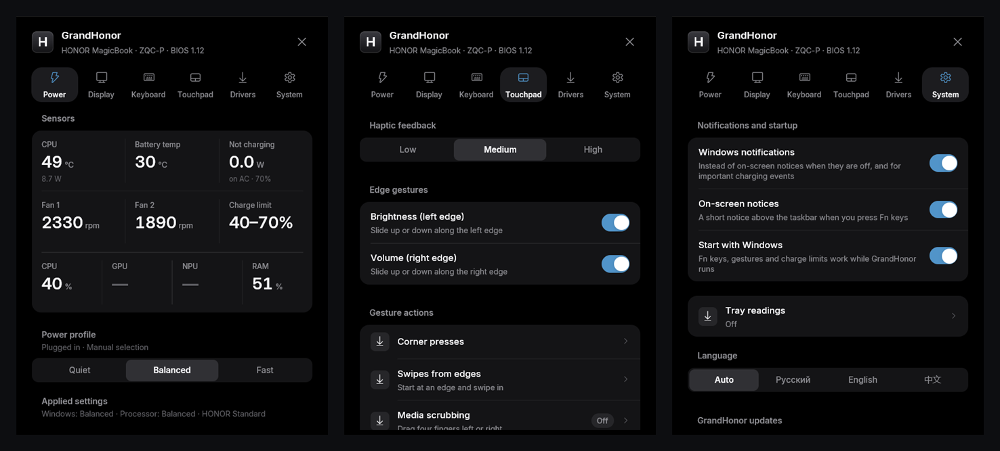
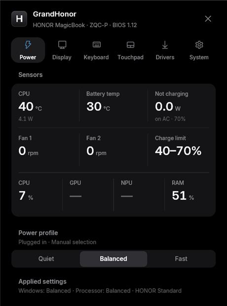
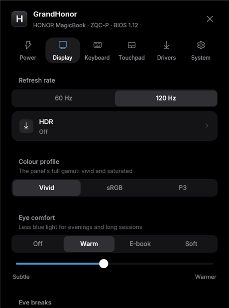
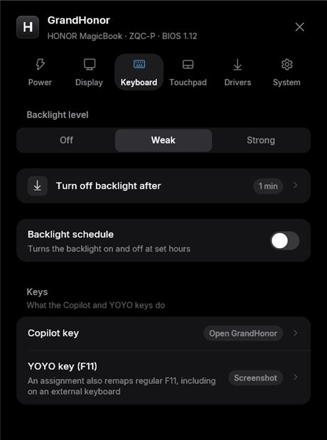
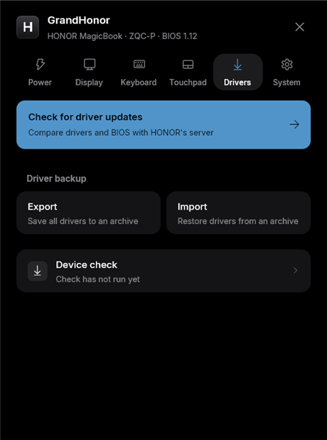
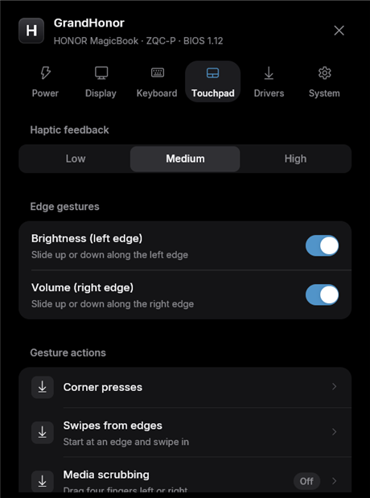
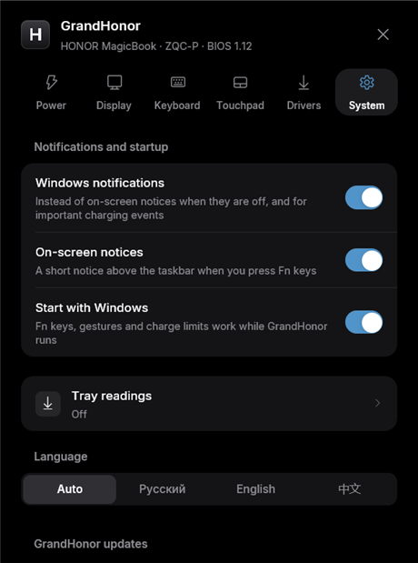

# GrandHonor

**A light, ad-free control center for HONOR MagicBook laptops.** 
Fn keys, battery care, fans and sensors, display colour and drivers — without HONOR PC Manager.

**English** · [Русский](README.ru.md) · [简体中文](README.zh.md)

### [⬇ Download GrandHonor](https://github.com/TheToxicFactory/GrandHonor/releases/latest)

## Why GrandHonor

HONOR PC Manager shows ads, feels heavy and often misbehaves — yet without it the Fn keys, touchpad gestures and battery charge limits stop working. GrandHonor does the same job quietly and adds what the stock app is missing.

- **Light.** A small tray app with no GPU rendering while idle. Live readings run when you view them or enable tray readings.
- **Private.** No ads, accounts or telemetry. Network requests are for GrandHonor update checks (including the optional hourly check), driver checks or the separate internet check.
- **Complete.** Every HONOR app can be uninstalled: GrandHonor replaces PC Manager and HONOR OSD. Keep the HONOR drivers.
- **Safe.** Drivers and updates are checked before anything runs: against HONOR's or GitHub's SHA-256 where one is published, otherwise by HONOR's signature on the installer; a failed update rolls back by itself.

## Features

| | |
|---|---|
| ⚡ **Power** | Live CPU, GPU, NPU and RAM usage where available · CPU and battery temperature, fans, watts and charge limit · **Quiet, Balanced and Fast** profiles for AC and battery coordinate Windows, the processor and HONOR mode (`Fn+P`) · charger presets · **Quiet nights** · **App profiles** |
| 🔋 **Battery** | Charge limits (Home 40–70 %, Office 70–90 %, Travel) · **Smart charging** · **Charge to 100 % once** · battery health and its change over time · notices at the limit, at 20 %, when hot and after sleep |
| 🖥 **Display** | Built-in display refresh rate · **HDR** with AC and app rules and calibration profiles · **Vivid, sRGB, P3** colour profiles · **Eye comfort** and eye-break reminders · **Screen care** and monochrome icons |
| ⌨️ **Keyboard** | Backlight level, auto-off and schedule · your own action for the **Copilot** and **YOYO** keys |
| 🖱 **Touchpad** | Haptic strength · edge swipes for brightness and volume · corner actions and one- or two-finger edge swipes on supported touchpads · four-finger media scrubbing in compatible players |
| 🧰 **Drivers** | HONOR driver and BIOS updates · driver backup · **Device check**: hardware and Windows diagnostics, device repair, driver rollback, NVMe health and system report |
| 🎛 **Everyday** | On-screen notices · `F7` microphone with LED · `F8` camera · `F12` screen snip · tray readings and right-click menu · English, Русский, 中文 |

## Screenshots

<table>
  <tr>
    <td></td>
    <td></td>
    <td></td>
  </tr>
  <tr>
    <td align="center">Power and sensors</td>
    <td align="center">Colour and eye comfort</td>
    <td align="center">Backlight and keys</td>
  </tr>
  <tr>
    <td></td>
    <td></td>
    <td></td>
  </tr>
  <tr>
    <td align="center">Drivers and device check</td>
    <td align="center">Touchpad</td>
    <td align="center">System</td>
  </tr>
</table>

## Install

1. Download **GrandHonor-Setup-x64.exe** from the [latest release](https://github.com/TheToxicFactory/GrandHonor/releases/latest).
2. Run it and confirm the administrator prompt — GrandHonor talks to the laptop's firmware.
3. Keep **Start GrandHonor with Windows** ticked and finish. The **H** icon appears next to the clock.

> [!TIP]
> No installer wanted? Unzip **GrandHonor-win-x64.zip** and run `GrandHonor.exe`. It works the same, but does not start with Windows.

> [!NOTE]
> The setup is not code-signed yet, so Windows SmartScreen may warn: choose **More info → Run anyway**.

### Requirements

- An **HONOR MagicBook** with HONOR's firmware interface. Tested on MagicBook ZQC-P (Intel Core Ultra X7 358H, BIOS 1.12).
- **Windows 11** x64. Nothing else: no runtimes, no HONOR apps.

## Use

- **Click the tray icon** to open the panel; click anywhere else or press `Esc` to close it.
- **Right-click** for a quick menu: power mode, Eye comfort, microphone, Open, Quit.
- GrandHonor must keep running for the Fn keys, gestures and charge limits. Closing the panel keeps it running; **System → Quit** stops it completely.

| Key | Action |
|---|---|
| `Fn+P` | Quiet → Balanced → Fast |
| `F7` | Microphone on / off (all microphones, with the key's LED) |
| `F8` | Camera on / off |
| `F12` | Screen snip |
| Refresh-rate key | 60 Hz (or the lowest available rate) ↔ highest available rate on the built-in screen |
| Copilot, YOYO (`F11`) | Your choice in **Keyboard → Keys** |

To update GrandHonor, open **System → Check for GrandHonor updates** and choose **Install version** when one is available. If installation fails, the previous version comes back. To remove GrandHonor, open **Settings → Apps → Installed apps → GrandHonor**.

## Help

📖 [User guide](docs/guide.md) · ❓ [FAQ and troubleshooting](docs/faq.md) · 🐞 [Report a problem](https://github.com/TheToxicFactory/GrandHonor/issues/new/choose) · 🔒 [Security](SECURITY.md)

When reporting a problem, attach **Drivers → Device check → System report**: it copies the model, BIOS, Windows version and the event log.

## License

GrandHonor is free and open source under the [MIT License](LICENSE). The embedded Inter font is under the SIL Open Font License. 
GrandHonor is an independent project and is not affiliated with or endorsed by HONOR Device Co., Ltd. HONOR and MagicBook are trademarks of their owner.
