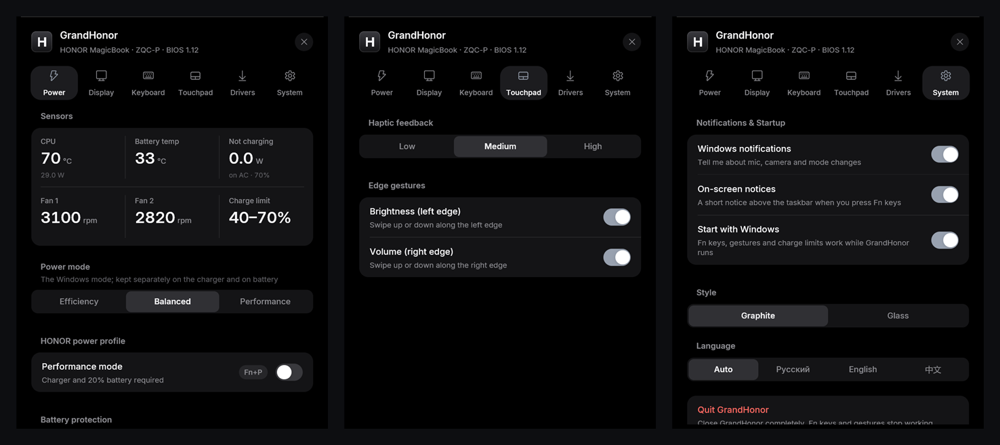
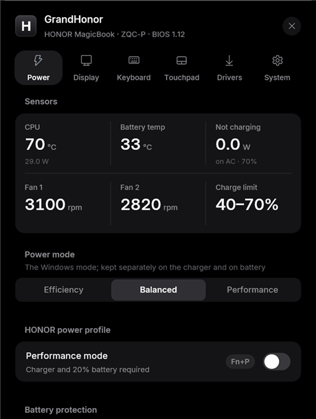
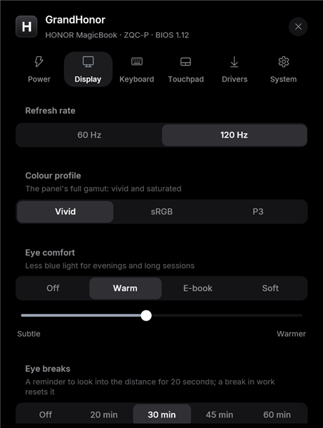
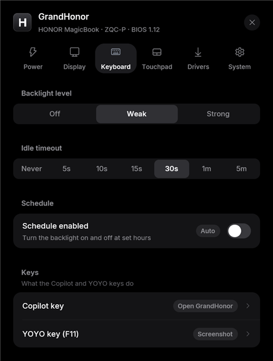
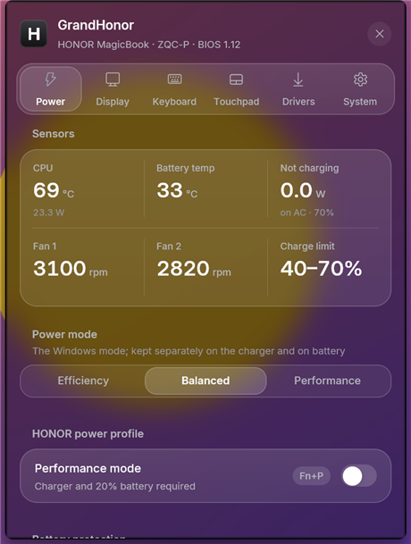
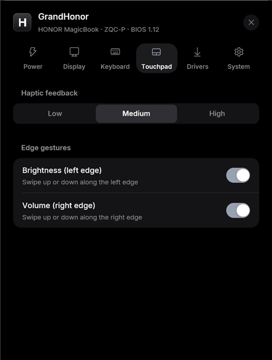
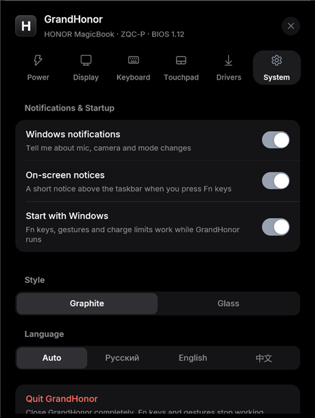

# GrandHonor

**Лёгкий центр управления для ноутбуков HONOR MagicBook — без рекламы.** 
Клавиши Fn, забота о батарее, вентиляторы и датчики, цвета экрана и драйверы — без HONOR PC Manager.

[English](README.md) · **Русский** · [简体中文](README.zh.md)

### [⬇ Скачать GrandHonor](https://github.com/TheToxicFactory/GrandHonor/releases/latest)

## Зачем GrandHonor

HONOR PC Manager показывает рекламу, тормозит и часто сбоит, но без него перестают работать клавиши Fn, жесты тачпада и лимиты заряда батареи. GrandHonor делает ту же работу тихо и добавляет то, чего в штатной программе нет.

- **Лёгкий.** Небольшая программа в трее, в простое не нагружает видеокарту. Датчики читаются, только пока вы на них смотрите.
- **Приватный.** Без рекламы, аккаунтов и телеметрии. В интернет выходит, только когда вы проверяете обновления или драйверы.
- **Полный.** Все программы HONOR можно удалить: GrandHonor заменяет PC Manager и HONOR OSD. Драйверы HONOR оставьте.
- **Безопасный.** Драйверы и обновления проверяются (подпись и SHA-256) до запуска; неудачное обновление откатывается само.

## Возможности

| | |
|---|---|
| ⚡ **Питание** | Температура процессора и батареи, вентиляторы, мощность и лимит заряда в реальном времени · режимы питания Windows и производительный режим HONOR (`Fn+P`) · пресеты для зарядки и батареи · **Тихие ночи** · **Профили программ** для игр и тяжёлых приложений |
| 🔋 **Батарея** | Лимиты заряда (Дом 40–70 %, Офис 70–90 %, Поездки) · **Умная зарядка** · **Зарядить до 100 % один раз** · здоровье батареи и его изменение со временем · уведомления о лимите, 20 %, нагреве и расходе во сне |
| 🖥 **Экран** | 60 / 120 Гц · цветовые профили **Яркий, sRGB, P3** · **Защита зрения** с ползунком теплоты, режимы «Книга» и «Мягкий» · напоминания **об отдыхе для глаз** |
| ⌨️ **Клавиатура** | Яркость, автоотключение и расписание подсветки · своё действие для клавиш **Copilot** и **YOYO** |
| 🖱 **Тачпад** | Сила тактильного отклика · жесты у края для яркости и громкости |
| 🧰 **Драйверы** | Обновления драйверов и BIOS от HONOR · резервная копия драйверов · **Проверка устройств**: починка устройств с ошибками, откат драйвера, здоровье SSD, перезапуск Bluetooth и Wi-Fi, отчёт о системе |
| 🎛 **Каждый день** | Экранные подсказки для всех клавиш · `F7` микрофон с индикатором · `F8` камера · `F12` снимок экрана · меню по правому клику · стиль «Графит» или «Стекло» · English, Русский, 中文 |

## Снимки экрана

<table>
  <tr>
    <td></td>
    <td></td>
    <td></td>
  </tr>
  <tr>
    <td align="center">Питание и датчики</td>
    <td align="center">Цвета и защита зрения</td>
    <td align="center">Подсветка и клавиши</td>
  </tr>
  <tr>
    <td></td>
    <td></td>
    <td></td>
  </tr>
  <tr>
    <td align="center">Стиль «Стекло»</td>
    <td align="center">Тачпад</td>
    <td align="center">Система</td>
  </tr>
</table>

## Установка

1. Скачайте **GrandHonor-Setup-x64.exe** со страницы [последнего выпуска](https://github.com/TheToxicFactory/GrandHonor/releases/latest).
2. Запустите и подтвердите запрос администратора — GrandHonor работает с прошивкой ноутбука.
3. Оставьте галочку **Запускать GrandHonor вместе с Windows** и завершите установку. Значок **H** появится рядом с часами.

> [!TIP]
> Не нужен установщик? Распакуйте **GrandHonor-win-x64.zip** и запустите `GrandHonor.exe`. Всё работает так же, только без автозапуска.

> [!NOTE]
> Установщик пока не подписан сертификатом, поэтому SmartScreen может предупредить: нажмите **Подробнее → Выполнить в любом случае**.

### Требования

- **HONOR MagicBook** с интерфейсом прошивки HONOR. Проверено на MagicBook ZQC-P (Intel Core Ultra X7 358H, BIOS 1.12).
- **Windows 11** x64. Больше ничего: ни библиотек, ни программ HONOR.

## Использование

- **Нажмите на значок в трее**, чтобы открыть панель; щелчок в другом месте или `Esc` закрывает её.
- **Правый клик** — быстрое меню: режим питания, защита зрения, микрофон, выход.
- Чтобы работали клавиши Fn, жесты и лимиты заряда, GrandHonor должен быть запущен. Закрытие панели его не останавливает; **Система → Выход** закрывает полностью.

| Клавиша | Действие |
|---|---|
| `Fn+P` | Экономия → Баланс → Производительность |
| `F7` | Микрофон вкл./выкл. (все микрофоны, с индикатором на клавише) |
| `F8` | Камера вкл./выкл. |
| `F12` | Снимок экрана |
| Клавиша частоты | 60 ↔ 120 Гц |
| Copilot, YOYO (`F11`) | По вашему выбору в **Клавиатура → Клавиши** |

**Обновления:** Система → Проверить обновление устанавливает новую версию с GitHub; если что-то пойдёт не так, вернётся прежняя. **Удаление:** Параметры → Приложения → Установленные приложения → GrandHonor.

## Помощь

📖 [Руководство](docs/guide.ru.md) · ❓ [Вопросы и решения](docs/faq.ru.md) · 🐞 [Сообщить о проблеме](https://github.com/TheToxicFactory/GrandHonor/issues/new/choose) · 🔒 [Безопасность](SECURITY.md)

К сообщению о проблеме приложите **Драйверы → Проверка устройств → Отчёт о системе**: он копирует модель, BIOS, версию Windows и журнал событий.

## Лицензия

GrandHonor — свободная программа с открытым кодом под [лицензией MIT](LICENSE). Встроенный шрифт Inter распространяется по SIL Open Font License. 
GrandHonor — независимый проект, не связанный с HONOR Device Co., Ltd. и не одобренный ею. HONOR и MagicBook — товарные знаки их владельца.
