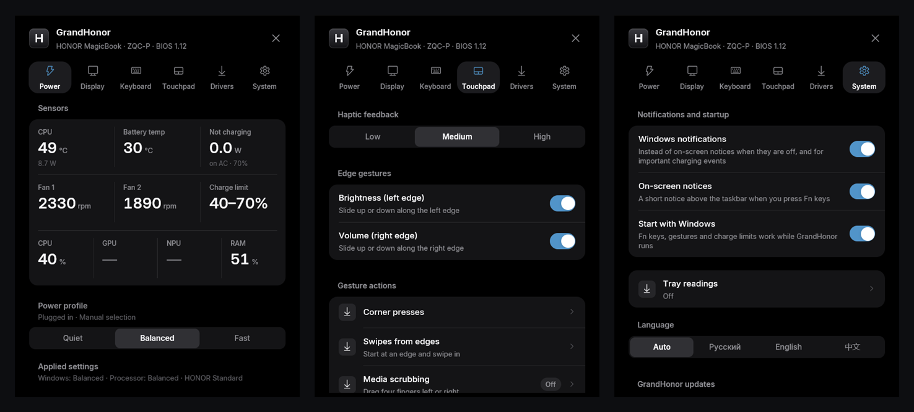
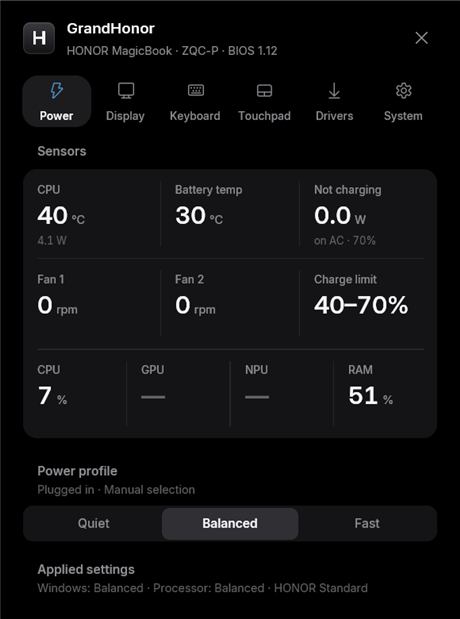
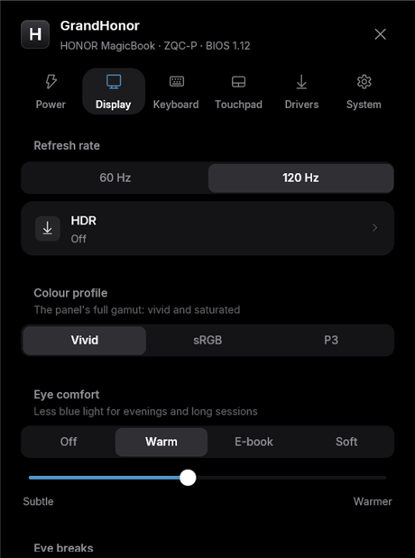
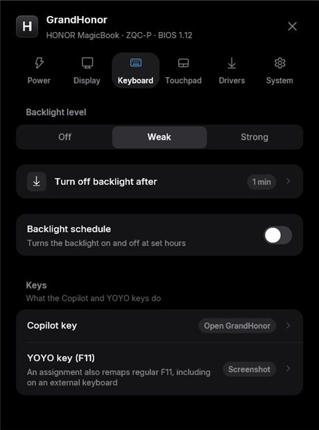
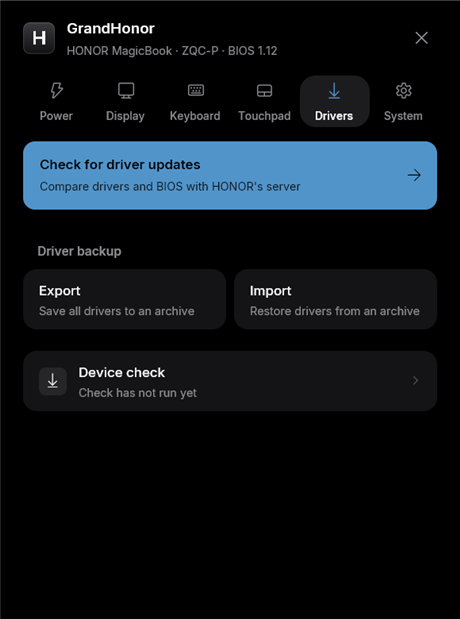
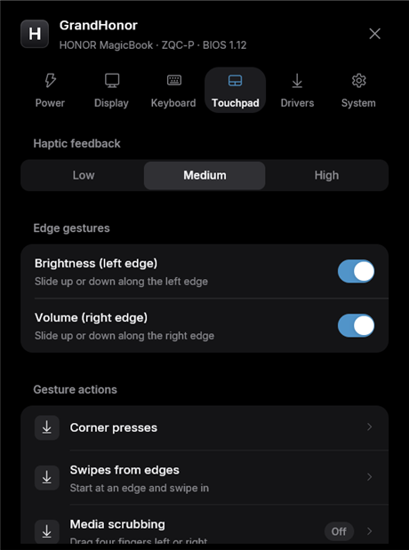
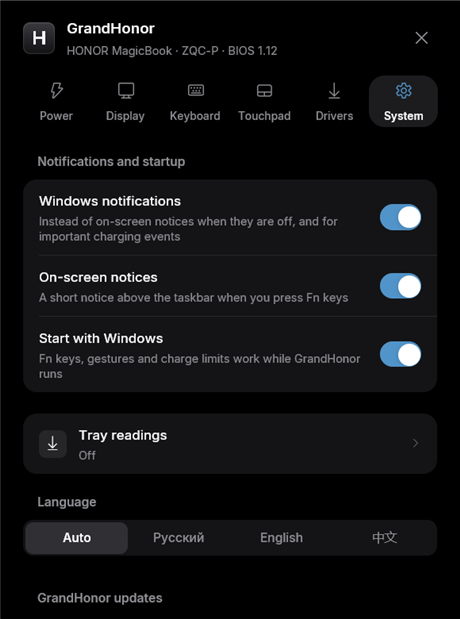

# GrandHonor

**为荣耀 MagicBook 笔记本打造的轻量、无广告控制中心。** 
Fn 键、电池养护、风扇与传感器、屏幕色彩与驱动 —— 无需荣耀电脑管家。

[English](README.md) · [Русский](README.ru.md) · **简体中文**

### [⬇ 下载 GrandHonor](https://github.com/TheToxicFactory/GrandHonor/releases/latest)

## 为什么选择 GrandHonor

荣耀电脑管家会显示广告、运行沉重且时常出错，但卸载后 Fn 键、触控板手势和电池充电上限都会失效。GrandHonor 安静地完成同样的工作，并补上原厂软件缺少的功能。

- **轻量。** 小巧的托盘程序，空闲时不使用 GPU 渲染。查看读数或启用托盘读数时更新传感器。
- **隐私。** 无广告、无账户、无遥测。联网仅用于 GrandHonor 更新检查（含可关闭的每小时检查）、驱动检查或单独的互联网连接检查。
- **完整。** 可以卸载所有荣耀软件：GrandHonor 取代电脑管家和 HONOR OSD。请保留荣耀驱动程序。
- **安全。** 驱动与更新在运行前均经过校验：有 HONOR 或 GitHub 公布的 SHA-256 时按其校验，否则校验安装程序的 HONOR 签名；更新失败会自动回退。

## 功能

| | |
|---|---|
| ⚡ **电源** | 读取可用的 CPU、GPU、NPU 与内存实时使用率 · CPU 与电池温度、风扇、功率和充电上限 · 接通电源和使用电池可分别选择**安静、平衡和快速**配置，联动 Windows、处理器和荣耀模式（`Fn+P`）· 电源切换预设 · **安静夜间** · **应用配置** |
| 🔋 **电池** | 充电上限（居家 40–70 %、办公 70–90 %、出行）· **智能充电** · **单次充满 100 %** · 电池健康度及其变化 · 到达上限、剩余 20 %、过热和睡眠耗电提示 |
| 🖥 **显示** | 内置屏幕刷新率 · **HDR** 电源与应用规则和校准配置 · 色彩配置 **鲜艳、sRGB、P3** · **护眼**和休息提醒 · **屏幕保护**与单色图标 |
| ⌨️ **键盘** | 背光亮度、自动关闭与计划 · 自定义 **Copilot** 键与 **YOYO** 键功能 |
| 🖱 **触控板** | 触觉反馈强度 · 边缘滑动调节亮度与音量 · 在兼容触控板上设置角落操作和单指或双指边缘手势 · 在兼容播放器中用四指拖动播放进度 |
| 🧰 **驱动** | 荣耀驱动与 BIOS 更新 · 驱动备份 · **设备检查**：硬件和 Windows 诊断、设备修复、驱动回退、NVMe 健康状况和系统报告 |
| 🎛 **日常** | 屏幕提示 · `F7` 麦克风（带指示灯）· `F8` 摄像头 · `F12` 截图 · 托盘读数和右键菜单 · English、Русский、中文 |

## 截图

<table>
  <tr>
    <td></td>
    <td></td>
    <td></td>
  </tr>
  <tr>
    <td align="center">电源和传感器</td>
    <td align="center">色彩和护眼</td>
    <td align="center">背光和按键</td>
  </tr>
  <tr>
    <td></td>
    <td></td>
    <td></td>
  </tr>
  <tr>
    <td align="center">驱动和设备检查</td>
    <td align="center">触控板</td>
    <td align="center">系统</td>
  </tr>
</table>

## 安装

1. 从[最新版本](https://github.com/TheToxicFactory/GrandHonor/releases/latest)下载 **GrandHonor-Setup-x64.exe**。
2. 运行并确认管理员权限提示 —— GrandHonor 需要与笔记本固件通信。
3. 保持勾选**开机启动 GrandHonor** 并完成安装。时钟旁会出现 **H** 图标。

> [!TIP]
> 不想安装？解压 **GrandHonor-win-x64.zip** 并运行 `GrandHonor.exe`，功能相同，但不会开机自启。

> [!NOTE]
> 安装程序尚未进行代码签名，SmartScreen 可能会提示：选择**更多信息 → 仍要运行**。

### 系统要求

- 带有荣耀固件接口的 **荣耀 MagicBook**。已在 MagicBook ZQC-P（Intel Core Ultra X7 358H，BIOS 1.12）上测试。
- **Windows 11** x64。无需其他任何组件或荣耀软件。

## 使用

- **单击托盘图标**打开面板；单击其他位置或按 `Esc` 关闭。
- **右键单击**打开快捷菜单：电源模式、护眼、麦克风、打开、退出。
- Fn 键、手势和充电上限需要 GrandHonor 保持运行。关闭面板不会退出；**系统 → 退出**才会完全关闭。

| 按键 | 功能 |
|---|---|
| `Fn+P` | 安静 → 平衡 → 快速 |
| `F7` | 麦克风开关（所有麦克风，带按键指示灯） |
| `F8` | 摄像头开关 |
| `F12` | 截图 |
| 刷新率键 | 内置屏幕的 60 Hz（或最低可用刷新率）↔ 最高可用刷新率 |
| Copilot、YOYO（`F11`） | 在**键盘 → 按键**中自选 |

要更新 GrandHonor，请打开 **系统 → 检查 GrandHonor 更新**，有新版本时选择 **安装版本**。安装失败会恢复原版本。要卸载 GrandHonor，请打开 **设置 → 应用 → 已安装的应用 → GrandHonor**。

## 帮助

📖 [使用指南（英文）](docs/guide.md) · ❓ [常见问题（英文）](docs/faq.md) · 🐞 [报告问题](https://github.com/TheToxicFactory/GrandHonor/issues/new/choose) · 🔒 [安全](SECURITY.md)

报告问题时，请附上**驱动 → 设备检查 → 系统报告**：它会复制型号、BIOS、Windows 版本和事件日志。

## 许可证

GrandHonor 是基于 [MIT 许可证](LICENSE)的免费开源软件。内置 Inter 字体采用 SIL Open Font License。 
GrandHonor 是独立项目，与荣耀终端有限公司无关，也未获其认可。HONOR 与 MagicBook 是其所有者的商标。
