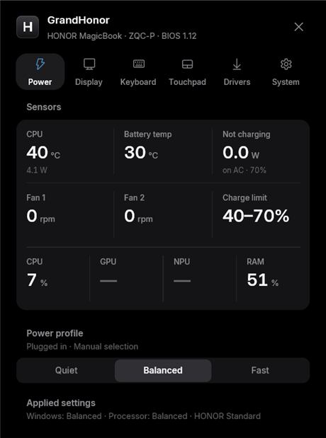
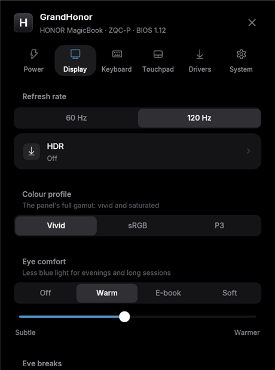
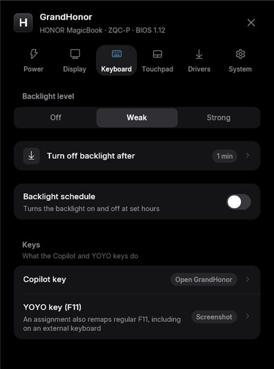
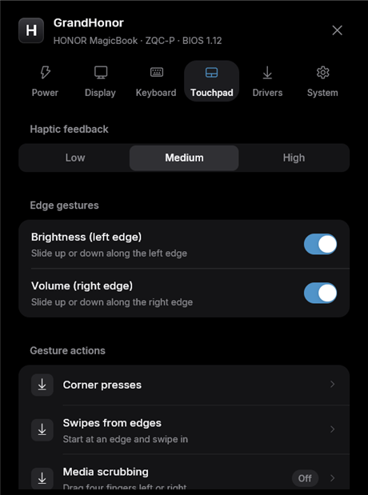
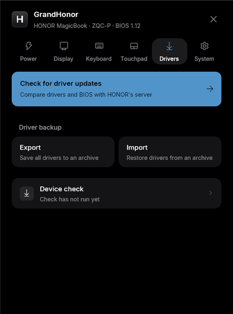
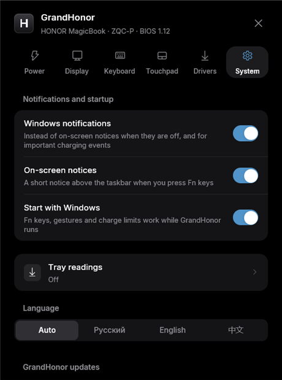

# User guide

[README](../README.md) · **Guide** · [FAQ](faq.md) · [Русский](guide.ru.md)

GrandHonor lives in the tray, next to the clock. **Click** the **H** icon to open the panel; click anywhere else, press `Esc` or × to close it. **Hover** the icon to see the HONOR mode and sensors, **right-click** it for a quick menu (power mode, Eye comfort, microphone, Open, Quit). Closing the panel does not stop GrandHonor — it has to keep running for the Fn keys, gestures and charge limits.

Changes made with keys and from the tray show a short notice above the taskbar. Turn notices off in **System → On-screen notices**; reminders and battery notices then arrive as Windows notifications.

---

## ⚡ Power

**Sensors** refresh twice a second while this tab is open. The load row shows CPU, GPU, NPU and RAM usage in percent about once a second. For GPU and NPU, the value is the busiest engine that Windows reports. A dash means there is no fresh reading. The battery tile shows **Charging power** and USB-C charger power on AC, and the whole laptop's **Draw** and charge percentage on battery.

**Power profile** links the Windows mode, processor settings and HONOR firmware. Select **Quiet**, **Balanced** or **Fast**. GrandHonor remembers a profile for each power source. The panel, tray menu and `Fn+P` all use the same profiles. After an update, your old settings continue to apply until you first choose a profile.

**Fast** requests HONOR Performance when Windows accepts Performance mode, the charger is connected, the battery has at least 20 % and HUNTER is off. **Applied settings** shows what changed and why a part of the profile could be unavailable.

**Battery protection** keeps the battery healthy on a laptop that is often plugged in:

| Mode | Charges to | For |
|---|---|---|
| Unrestricted | 100 % | full capacity every time |
| Home | 40–70 % | long hours on the charger |
| Office | 70–90 % | everyday use |
| Travel | 95–100 % | trips |

The title shows **battery health** (capacity against the original), charge cycles and how it changed over the months.

- **Smart charging** — after 3 hours on the charger, holds 70–90 % until you unplug.
- **Charge to 100 % once** — before a trip: lifts the limit until the battery is full or you unplug, then the limit comes back.
- **Charge notices** — when charging stops at the limit, at 20 % left, when the battery passes 50 °C and after sleeping on battery (for example "Sleep 8 h: −4%").

**Power presets** set keyboard light, screen brightness and refresh rate when you plug in or unplug. **Apply now** saves the chosen profile for that source. The other settings apply when that source is active.

**Quiet nights** request Quiet during the scheduled hours (23:00–07:00 by default). **App profiles** request Fast and the highest refresh rate while a selected program runs. At night, Quiet takes precedence over the app's power profile. If you choose a profile during a scenario, it takes precedence until that scenario ends or the power source changes. GrandHonor restores the earlier refresh rate if you kept the rate selected by the program. To remove a program, click it twice.

 

---

## 🖥 Display

- **Refresh rate** — choose a supported rate for the built-in screen. The refresh-rate key switches it too.
- **HDR** — switch HDR on the built-in display, choose an installed Windows HDR calibration profile, or turn on HDR on AC or while a chosen program runs. **Open HDR settings** opens the Windows page for SDR brightness, Auto HDR and calibration.
- **Colour profile** — **Vivid** uses the panel's full colour range; **sRGB** gives accurate colours for the web, photos and office work; **P3** is the wide gamut of Apple displays. The profiles are measured for the built-in screen of the MagicBook ZQC-P and appear only on that model.
- **Eye comfort**
  - **Warm** — less blue light; drag the **warmth slider** from subtle to warmer.
  - **E-book** — a warm monochrome for reading that follows the time of day.
  - **Soft** — slightly calmer saturation and white balance.
- **Eye breaks** — every 20–60 minutes a reminder to look into the distance for 20 seconds. Five minutes away from the laptop count as a break; a full-screen game, video or presentation postpones the reminder.
- **Video** (Intel graphics only) — the driver's own enhancements for video in Windows players such as Media Player (browsers, YouTube included, are not affected): **Sharpness**, **Noise reduction** (Auto picks the level itself), **Contrast** and **Skin tone**. The driver keeps these settings itself; they also work when GrandHonor is closed.

The sRGB and P3 adjustments use values measured for the built-in panel and pause when an external display is active. Colour filters pause while HDR is enabled.

In **Screen care**, drag the brightness slider to adjust the built-in screen. Open **On AC** or **On battery** to choose the corresponding screen-off timeout in the current Windows power plan. You can also open taskbar settings or make the GrandHonor tray icon or a selected desktop shortcut monochrome. Choose the same shortcut again to restore its original icon.

 

---

## ⌨️ Keyboard

- **Backlight level** — Off, Weak, Strong. The keyboard's own backlight key works as well.
- **Turn off backlight after** — open the row showing the current value and choose 5 s to 5 min without typing, or Never.
- **Backlight schedule** — turn the backlight on and off at set hours (the hours and level appear when it is on).
- **Keys** — choose what the **Copilot** key and the **YOYO** key (`F11`) do: open GrandHonor, take a screenshot, switch the microphone, the power mode or Eye comfort, or open a program you pick. **Windows default** keeps `F11` as it is. Assigning an action to YOYO also remaps regular `F11`, including on an external keyboard.

 

---

## 🖱 Touchpad

- **Haptic feedback** — how strong the touchpad's click feels.
- **Edge gestures** — slide along the left edge for screen brightness, along the right edge for volume.
- **Gesture actions** — open **Corner presses** or **Swipes from edges** to assign a corner click or an inward swipe with one or two fingers. Available gestures depend on the touchpad. Each can open GrandHonor, minimize the active window or take a screenshot. New assignments start off. Windows can also handle the click in a bottom corner or the scrolling from an edge swipe.
- **Media scrubbing** — in **Windows Settings → Bluetooth & devices → Touchpad → Advanced gestures**, choose **Nothing** for four-finger swipes left and right. This replaces any shortcuts you assigned for earlier versions. Leave the up and down assignments as they are to keep vertical volume control. In a compatible player, place four fingers on the pad and drag left or right. When on-screen notices are enabled, the timeline previews the selected position as you drag. Lift your fingers to seek to that point.

 

---

## 🧰 Drivers

- **Check for driver updates** asks HONOR for drivers and BIOS for this exact laptop. Each package is checked before it can run: against HONOR's SHA-256 when HONOR publishes one, otherwise by HONOR's signature on its installer (the other files in such a package are not checked one by one); you can also save it.
- **Install BIOS** works only on the charger with at least 30 % battery. Keep the laptop on: it restarts by itself.
- **Driver backup** — **Export** saves all installed drivers to an archive, **Import** puts them back.
- **Device check**
  - Select **Run check** to check the hardware and Windows settings. Expand a group for individual results. You can cancel the check and keep the results collected so far.
  - Sound, camera, microphone and touchpad tests ask you to confirm what you hear or see. The memory checks cover 8 MiB allocated for the test. **Check internet access** sends a separate HTTPS request to Microsoft.
  - Devices with an error are listed with the reason. Open one to **restart** it or **roll back its driver** to the previous version (click twice to confirm).
  - The NVMe health report shows wear, temperature, data written and hours when the drive provides them.
  - **Restart Bluetooth** or **Restart Wi-Fi** when a device will not connect (click twice: the connection drops for a few seconds).
  - **Scan for hardware changes**, as in Device Manager.
  - **System report** copies the model, BIOS, Windows version, battery, SSD, devices and GrandHonor's log — attach it when you report a problem. **GrandHonor log** opens that log file.

 

---

## ⚙️ System

- **Tray readings** — choose temperature and fan icons, then pin them through Windows. A dash means there is no fresh reading. The fan icon shows the faster fan in thousands of rpm. Monitoring pauses when the display turns off.

- **Windows notifications**, **On-screen notices**, **Start with Windows**.
- **Language** — Auto, Русский, English, 中文.
- **Automatic checks** — about once an hour, GrandHonor queries GitHub for a new GrandHonor release and sends a notice when it finds one. This is on by default. Use the switch under **GrandHonor updates** to turn it off. To install an update, use the manual check.
- **Check for GrandHonor updates** — looks for a new GrandHonor release on GitHub. Choose **Install version** to download and install it. If installation fails, the previous version comes back by itself. **Roll back** returns to the stored previous version. To update the portable copy, download the installer.
- **Export / Import settings** — a JSON file; importing restarts GrandHonor.
- **Quit GrandHonor** — closes it completely: Fn keys and gestures stop until you start it again.

 

---

## Keys

| Key | What happens |
|---|---|
| `Fn+P` | Quiet → Balanced → Fast |
| `F7` | All microphones on / off, with the key's LED |
| `F8` | Camera on / off (an app that tries to use a switched-off camera or microphone gets a notice) |
| `F12` | Screen snip |
| Refresh-rate key | 60 Hz (or the lowest available rate) ↔ highest available rate on the built-in screen |
| Backlight, touchpad, Fn lock keys | Work as printed, with a notice |
| Copilot, YOYO (`F11`) | Your choice in Keyboard → Keys |

## Removing GrandHonor

Settings → Apps → Installed apps → GrandHonor → Uninstall. The uninstaller removes the program, its startup task and the tray entry, and can also clear your settings. If HONOR OSD is still installed, it is turned back on; a camera you switched off with F8 is switched back on. GrandHonor needs an administrator account (it asks for elevation at start).
