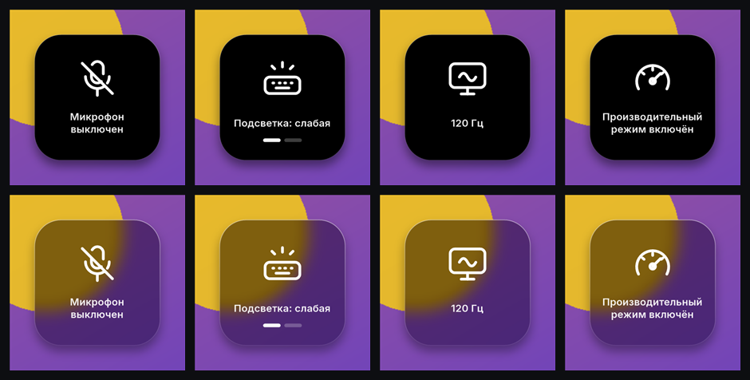

# User guide

[README](../README.md) · **Guide** · [FAQ](faq.md) · [Русский](guide.ru.md)

GrandHonor lives in the tray, next to the clock. **Click** the **H** icon to open the panel; click anywhere else, press `Esc` or × to close it. **Hover** the icon to see the HONOR mode and sensors, **right-click** it for a quick menu (power mode, Eye comfort, microphone, Open, Quit). Closing the panel does not stop GrandHonor — it has to keep running for the Fn keys, gestures and charge limits.

Every change shows a short notice above the taskbar. Turn notices off in **System → On-screen notices**; reminders and battery notices then arrive as Windows notifications.

---

## ⚡ Power

**Sensors** refresh twice a second while this tab is open: CPU temperature and power, battery temperature, both fans and the charge limit. The battery tile shows **Charging power** (going into the battery) on the charger, with the charger's USB-C power under it, and **Draw** (the whole laptop) on battery, with the percent. A dash means the firmware gave no fresh answer — GrandHonor never shows a guessed value.

**Power mode** is the Windows switch from Settings → Power: Efficiency, Balanced, Performance. Windows remembers one mode for the charger and one for battery. `Fn+P` cycles Efficiency → Balanced → Performance.

**Performance mode (HONOR)** switches the firmware profile; it needs the charger and at least 20 % battery.

**Battery protection** keeps the battery healthy on a laptop that is often plugged in:

| Mode | Charges to | For |
|---|---|---|
| Unrestricted | 100 % | full capacity every time |
| Home | 40–70 % | long hours on the charger |
| Office | 70–90 % | everyday use |
| Travel | 95–100 % | trips |

The title shows **battery health** (capacity against the original), charge cycles and how it changed over the months.

- **Smart charging** — after 3 hours on the charger, holds 70–90 % until you unplug.
- **Charge to 100 % once** — before a trip: lifts the limit until the battery is full or you unplug, then the limit comes back.
- **Charge notices** — when charging stops at the limit, at 20 % left, when the battery passes 50 °C and after sleeping on battery (for example "Sleep 8 h: −4%").

**Power presets** apply automatically when you plug in or unplug: Windows mode, keyboard light, screen brightness and refresh rate for each power source. **Apply now** tries a preset without unplugging.

**Quiet nights** switch to Efficiency mode between two hours (23:00–07:00 by default) for quieter fans. In the morning the previous mode returns, unless you changed it during the night.

**App profiles** — add a game or a heavy program: while it runs, GrandHonor uses Performance mode and the highest refresh rate, and puts both back when it closes (also after a restart). To remove a program, click it twice.

 

---

## 🖥 Display

- **Refresh rate** — 60 or 120 Hz. The refresh-rate key switches it too.
- **Colour profile** — **Vivid** uses the panel's full colour range; **sRGB** gives accurate colours for the web, photos and office work; **P3** is the wide gamut of Apple displays.
- **Eye comfort**
  - **Warm** — less blue light; drag the **warmth slider** from subtle to warmer.
  - **E-book** — a warm monochrome for reading that follows the time of day.
  - **Soft** — slightly calmer saturation and white balance.
- **Eye breaks** — every 20–60 minutes a reminder to look into the distance for 20 seconds. Five minutes away from the laptop count as a break; a full-screen game, video or presentation postpones the reminder.

Colour settings use HONOR's own values measured for this panel and work in every app.

 

---

## ⌨️ Keyboard

- **Backlight level** — Off, Weak, Strong. The keyboard's own backlight key works as well.
- **Idle timeout** — the backlight turns off after 5 s to 5 min without typing, or never.
- **Backlight schedule** — turn the backlight on and off at set hours (the hours and level appear when it is on).
- **Keys** — choose what the **Copilot** key and the **YOYO** key (`F11`) do: open GrandHonor, take a screenshot, switch the microphone, the power mode or Eye comfort, or open a program you pick. **Windows default** leaves the key as it is (a normal `F11` for YOYO).

 

---

## 🖱 Touchpad

- **Haptic feedback** — how strong the touchpad's click feels.
- **Edge gestures** — slide along the left edge for screen brightness, along the right edge for volume.

 

---

## 🧰 Drivers

- **Check for driver updates** asks HONOR for drivers and BIOS for this exact laptop. Each package is verified (signature, SHA-256) before it can run; you can also save it.
- **Install BIOS** works only on the charger with at least 30 % battery. Keep the laptop on: it restarts by itself.
- **Driver backup** — **Export** saves all installed drivers to an archive, **Import** puts them back.
- **Device check**
  - Devices with an error are listed with the reason. Open one to **restart** it or **roll back its driver** to the previous version (click twice to confirm).
  - **SSD health**: wear, temperature, data written and hours.
  - **Restart Bluetooth** or **Restart Wi-Fi** when a device will not connect (click twice: the connection drops for a few seconds).
  - **Scan for hardware changes**, as in Device Manager.
  - **System report** copies the model, BIOS, Windows version, battery, SSD, devices and the event log — attach it when you report a problem. **Event log** opens the log file.

---

## ⚙️ System

- **Windows notifications**, **On-screen notices**, **Start with Windows**.
- **Style** — **Graphite** (solid; OLED black in the dark theme) or **Glass** (frosted: the desktop shows through the panel and the notices).
- **Language** — Auto, Русский, English, 中文.
- **Check for GrandHonor updates** — downloads and installs a new GrandHonor from GitHub. If something fails, the previous version comes back by itself. **Roll back** returns to the stored previous version. In the portable copy both are unavailable: download the setup instead.
- **Export / Import settings** — a JSON file; importing restarts GrandHonor.
- **Quit GrandHonor** — closes it completely: Fn keys and gestures stop until you start it again.

 

---

## Keys

| Key | What happens |
|---|---|
| `Fn+P` | Efficiency → Balanced → Performance |
| `F7` | All microphones on / off, with the key's LED |
| `F8` | Camera on / off (an app that tries to use a switched-off camera or microphone gets a notice) |
| `F12` | Screen snip |
| Refresh-rate key | 60 ↔ 120 Hz |
| Backlight, touchpad, Fn lock keys | Work as printed, with a notice |
| Copilot, YOYO (`F11`) | Your choice in Keyboard → Keys |

## Removing GrandHonor

Settings → Apps → Installed apps → GrandHonor → Uninstall. The uninstaller removes the program, its startup task and the tray entry, and can also clear your settings. If HONOR OSD is still installed, it is turned back on.
