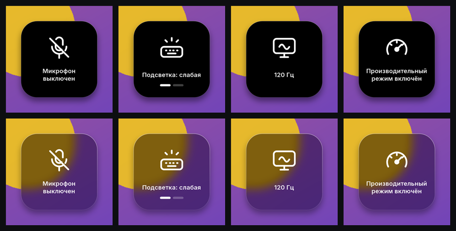
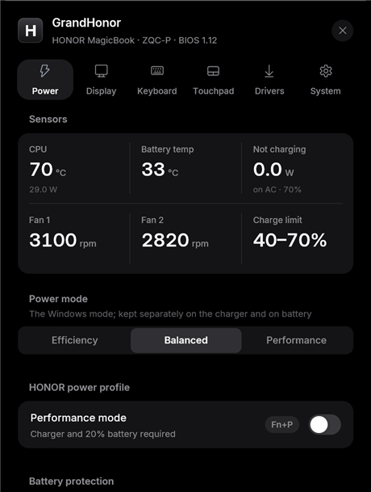
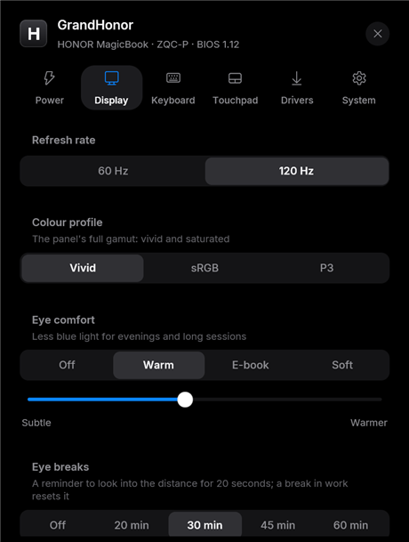
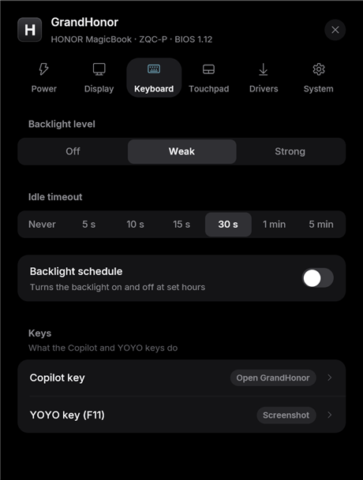
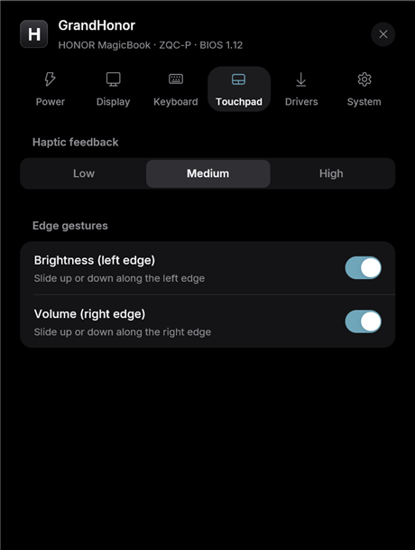
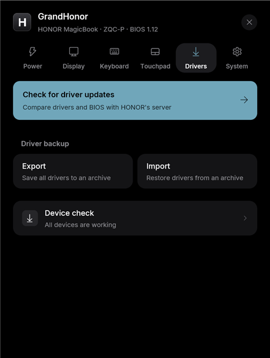
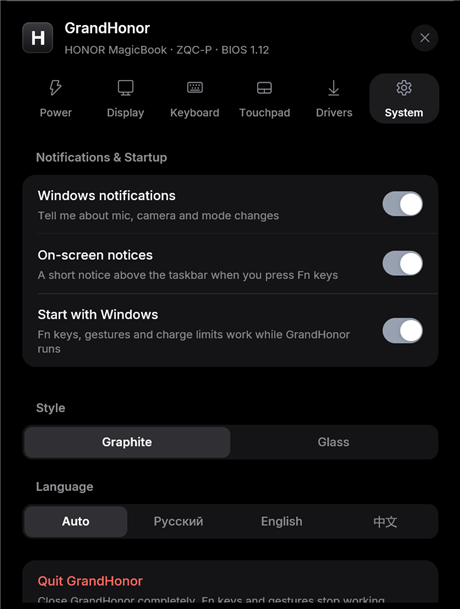

# Руководство

[README](../README.ru.md) · **Руководство** · [Вопросы](faq.ru.md) · [English](guide.md)

GrandHonor живёт в трее рядом с часами. **Нажмите** на значок **H**, чтобы открыть панель; щелчок в другом месте, `Esc` или × закрывают её. **Наведите** курсор на значок — увидите режим HONOR и датчики, **правый клик** открывает быстрое меню (режим питания, защита зрения, микрофон, открыть, выход). Закрытие панели не останавливает GrandHonor: он должен работать, чтобы действовали клавиши Fn, жесты и лимиты заряда.

Изменения с клавиш и из трея показывают короткую подсказку над панелью задач. Отключить их можно в **Система → Экранные подсказки**; напоминания и уведомления о батарее тогда приходят уведомлениями Windows.

---

## ⚡ Питание

**Датчики** обновляются дважды в секунду, пока открыта вкладка: температура и мощность процессора, температура батареи, оба вентилятора и лимит заряда. Плитка батареи показывает **Мощность заряда** (идущую в батарею) от сети, а под ней мощность USB-C зарядки, и **Расход** (весь ноутбук) от батареи, с процентом. Прочерк означает, что прошивка не дала свежего ответа: GrandHonor никогда не показывает выдуманных значений.

**Режим питания** — тот же переключатель, что в Параметрах Windows → Питание: Экономия, Баланс, Производительность. Windows помнит отдельный режим для зарядки и для батареи. `Fn+P` переключает Экономия → Баланс → Производительность.

**Профиль процессора** — отдельно для сети и для батареи: **Тихий** (без турбо, прохладнее и тише, дольше от батареи), **Баланс** (значения сбалансированной схемы Windows, записанные в текущую схему), **Быстрый** (быстрее отклик и выше частоты). Если Windows не даст изменить схему, останется прежний выбор. **Windows** оставляет схему питания как есть; её собственные значения возвращаются, когда для обоих выбрано «Windows», и при удалении GrandHonor.

**Производительный HONOR** включает профиль прошивки (выключен: **Обычный HONOR**); нужна зарядка и не меньше 20 % батареи.

**Защита батареи** бережёт батарею ноутбука, который часто стоит на зарядке:

| Режим | Заряжает до | Для чего |
|---|---|---|
| Без лимита | 100 % | полный заряд всегда |
| Дом | 40–70 % | долгая работа от сети |
| Офис | 70–90 % | каждый день |
| Поездки | 95–100 % | в дорогу |

В заголовке — **здоровье батареи** (ёмкость относительно новой), циклы зарядки и как ёмкость менялась по месяцам.

- **Умная зарядка** — после 3 часов на зарядке держит 70–90 %, пока вы не отключите зарядку.
- **Зарядить до 100 % один раз** — перед поездкой: снимает лимит до полного заряда или отключения зарядки, потом лимит возвращается сам.
- **Уведомления о заряде** — когда заряд дошёл до лимита, осталось 20 %, батарея нагрелась выше 50 °C и сколько ушло во сне (например «Сон 8 ч: −4%»).

**Пресеты питания** применяются сами, когда вы подключаете или отключаете зарядку: режим Windows, подсветка клавиатуры, яркость и частота экрана для каждого источника питания. **Применить сейчас** — проверить пресет, не трогая зарядку.

**Тихие ночи** включают «Экономию» между двумя часами (по умолчанию 23:00–07:00) — вентиляторы тише. Утром вернётся прежний режим, если вы не меняли его ночью.

**Профили программ** — добавьте игру или тяжёлую программу: пока она открыта, GrandHonor включает «Производительность» и наибольшую частоту экрана, а после закрытия возвращает всё как было (и после перезапуска). Чтобы убрать программу, нажмите на неё дважды.

 

---

## 🖥 Экран

- **Частота экрана** — 60 или 120 Гц. Переключает и клавиша частоты.
- **Цветовой профиль** — **Яркий**: полный охват панели; **sRGB**: точные цвета для интернета, фото и офиса; **P3**: широкий охват, как у экранов Apple. Профили рассчитаны для встроенного экрана MagicBook ZQC-P и показываются только на этой модели.
- **Защита зрения**
  - **Тёплый** — меньше синего света; **ползунок теплоты** тянется от слабее к теплее.
  - **Книга** — тёплый монохром для чтения, оттенок меняется со временем суток.
  - **Мягкий** — чуть спокойнее насыщенность и баланс белого.
- **Отдых для глаз** — каждые 20–60 минут напоминание посмотреть вдаль 20 секунд. Пять минут вдали от ноутбука считаются перерывом; полноэкранная игра, видео или презентация откладывают напоминание.

Цветовые настройки используют значения HONOR, измеренные для этой панели, и работают во всех программах.

 

---

## ⌨️ Клавиатура

- **Яркость подсветки** — Выкл., Слабая, Сильная. Клавиша подсветки на клавиатуре тоже работает.
- **Таймаут отключения** — подсветка гаснет через 5 с – 5 мин без нажатий или никогда.
- **Подсветка по расписанию** — включать и выключать подсветку в заданные часы (часы и яркость появляются, когда расписание включено).
- **Клавиши** — что делают клавиша **Copilot** и клавиша **YOYO** (`F11`): открыть GrandHonor, снимок экрана, микрофон, смена режима питания или защиты зрения, запуск выбранной программы. **Как в Windows** оставляет клавишу как есть (для YOYO — обычная `F11`).

 

---

## 🖱 Тачпад

- **Тактильный отклик** — насколько сильно ощущается нажатие тачпада.
- **Жесты по краям** — проведите вдоль левого края для яркости экрана, вдоль правого — для громкости.

 

---

## 🧰 Драйверы

- **Проверить драйверы** — запрос к HONOR драйверов и BIOS именно для этого ноутбука. Каждый пакет проверяется до запуска: по SHA-256 от HONOR, если HONOR его публикует, иначе по подписи HONOR на установщике (остальные файлы такого пакета по отдельности не проверяются); его можно и сохранить.
- **Установить BIOS** — только на зарядке и при заряде от 30 %. Не выключайте ноутбук: он перезагрузится сам.
- **Резервная копия драйверов** — **Экспорт** сохраняет все установленные драйверы в архив, **Импорт** возвращает их.
- **Проверка устройств**
  - Устройства с ошибками показаны с причиной. Откройте устройство, чтобы **перезапустить** его или **откатить драйвер** к прежней версии (нажмите дважды для подтверждения).
  - **Здоровье SSD**: износ, температура, сколько записано и часы работы.
  - **Перезапустить Bluetooth** или **Wi-Fi**, если устройство не подключается (нажмите дважды: связь пропадёт на несколько секунд).
  - **Найти новое оборудование**, как в диспетчере устройств.
  - **Отчёт о системе** копирует модель, BIOS, версию Windows, батарею, SSD, устройства и журнал событий — приложите его к сообщению о проблеме. **Журнал событий** открывает файл журнала.

 

---

## ⚙️ Система

- **Уведомления Windows**, **Экранные подсказки**, **Запускать с Windows**.
- **Язык** — Авто, Русский, English, 中文.
- **Проверить обновление GrandHonor** — скачивает и устанавливает новый GrandHonor с GitHub. Если что-то не так, прежняя версия вернётся сама. **Вернуть версию** — откат к сохранённой прошлой. В портативной версии обе кнопки недоступны: скачайте установщик.
- **Экспорт / Импорт настроек** — файл JSON; импорт перезапускает GrandHonor.
- **Выход из GrandHonor** — закрывает полностью: клавиши Fn и жесты не работают, пока вы снова не запустите программу.

 

---

## Клавиши

| Клавиша | Что происходит |
|---|---|
| `Fn+P` | Экономия → Баланс → Производительность |
| `F7` | Все микрофоны вкл./выкл., с индикатором на клавише |
| `F8` | Камера вкл./выкл. (программа, которой нужна выключенная камера или микрофон, получит подсказку) |
| `F12` | Снимок экрана |
| Клавиша частоты | 60 ↔ 120 Гц |
| Подсветка, тачпад, Fn Lock | Работают как подписано, с подсказкой |
| Copilot, YOYO (`F11`) | По вашему выбору в Клавиатура → Клавиши |

## Удаление

Параметры → Приложения → Установленные приложения → GrandHonor → Удалить. Деинсталлятор удаляет программу, задачу автозапуска и значок в трее и может стереть ваши настройки. Если HONOR OSD ещё установлен, он снова включается; камера, выключенная клавишей F8, включается обратно. Для работы GrandHonor нужна учётная запись администратора (при запуске он запрашивает повышение прав).
